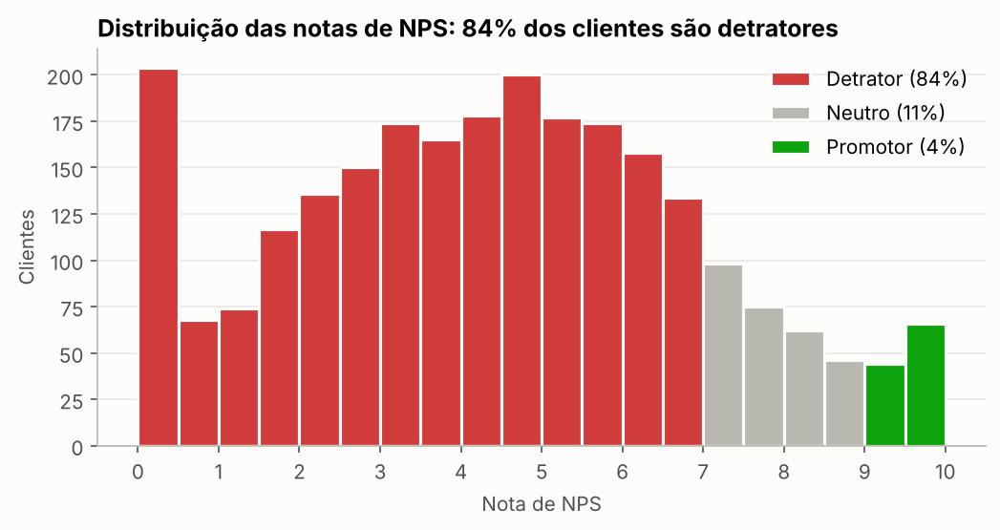
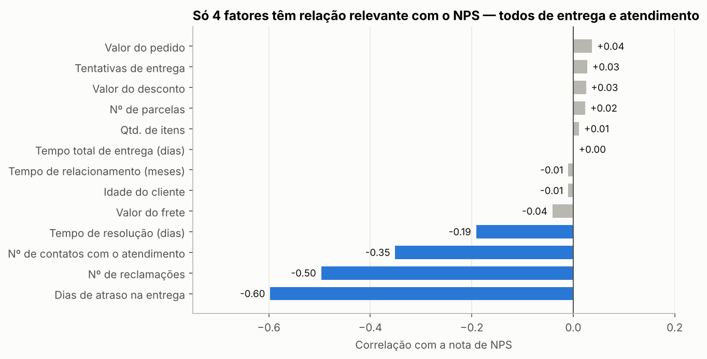
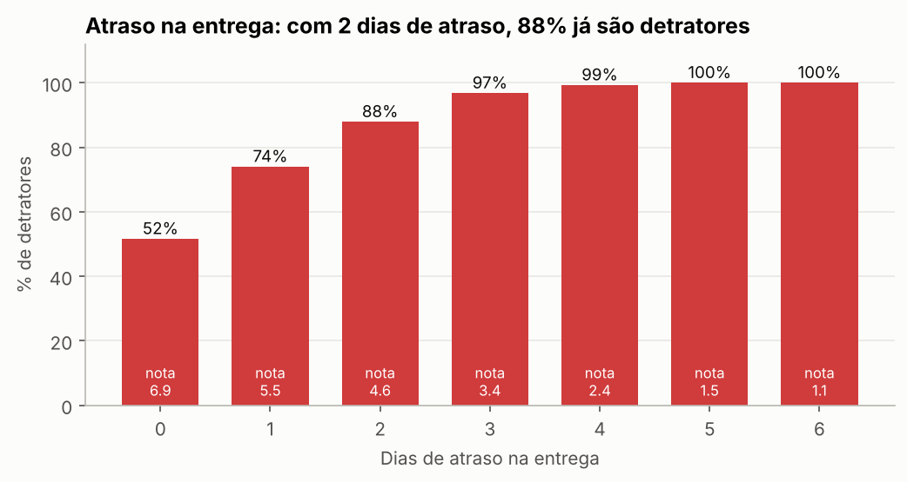
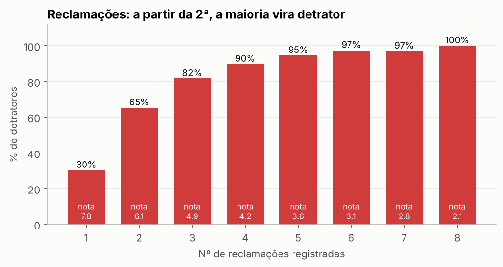
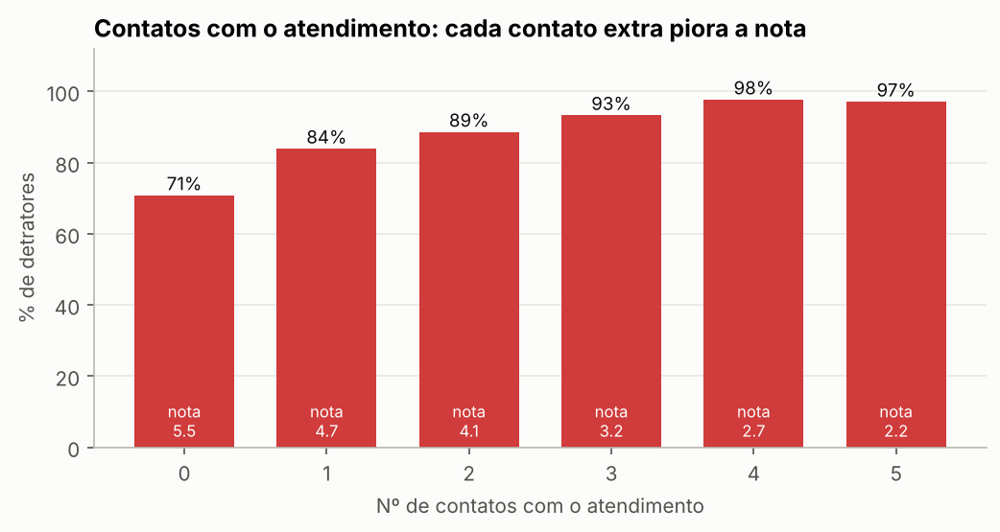
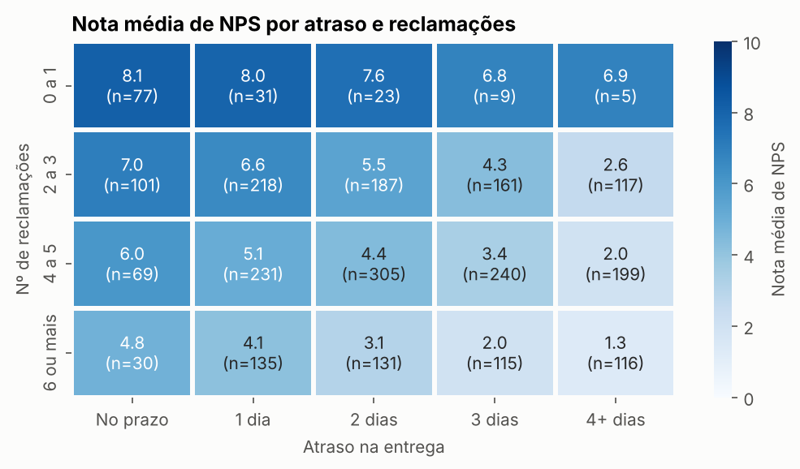
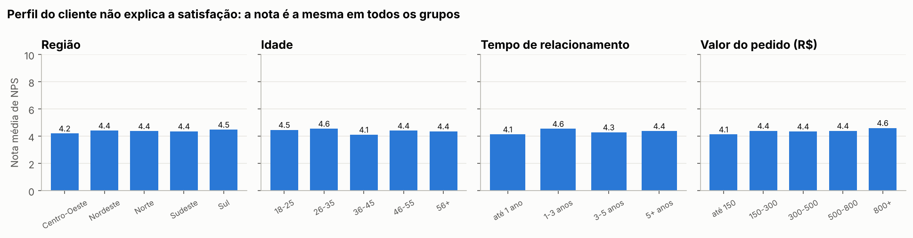

# 3. Análise Exploratória dos Dados (EDA)

Resumo em linguagem de negócio, escrito para quem cuida da operação. O código e os números
completos estão em [`notebooks/01_eda.ipynb`](../notebooks/01_eda.ipynb).

**O ponto de partida:** de cada 100 clientes, 84 são detratores (nota abaixo de 7), 11 são neutros
e só 4 são promotores. O NPS da base é **−80** e a nota média é 4,4.

## 3.1 Quais fatores parecem mais críticos para a satisfação?

**Resposta:** Quatro fatores, todos de entrega e atendimento, nesta ordem de peso:

1. **Dias de atraso na entrega** — o mais forte.
2. **Número de reclamações.**
3. **Número de contatos com o atendimento.**
4. **Tempo para resolver o problema.**

Valor do pedido, frete, desconto, parcelas, quantidade de itens e tentativas de entrega
praticamente não mexem na nota.

Um ponto importante para a logística: o **tempo total de entrega não afeta a satisfação**. Um
pedido que leva 12 dias e chega na data prometida é tão bem avaliado quanto um que leva 3. O que
derruba a nota é **prometer uma data e não cumprir**.

## 3.2 O que mais gera detratores?

**Resposta:** O atraso na entrega.

| Atraso na entrega | Nota média | Detratores |
|---|---|---|
| No prazo | 6,9 | 52% |
| 1 dia | 5,5 | 74% |
| 2 dias | 4,6 | 88% |
| 3 dias | 3,4 | 97% |
| 4 dias ou mais | 2,4 ou menos | 99% a 100% |

O tamanho do problema: **só 11% dos pedidos chegam no prazo**, e 64% chegam com 2 dias ou mais de
atraso.

Em segundo lugar vêm as **reclamações**. Com nenhuma ou uma reclamação, a nota média fica perto
de 8. Na segunda, cai para 6,1 e 65% dos clientes já são detratores. Com cinco, são 95%.

Os **contatos com o atendimento** seguem a mesma lógica: cada contato a mais piora a nota (5,5 sem
contato, 2,7 com quatro). O **tempo de resolução** pesa menos: de 75% de detratores quando o
problema é resolvido no mesmo dia para 91% quando leva 10 dias ou mais.

## 3.3 Existe algum "ponto de ruptura" na experiência do cliente?

**Resposta:** Sim, dois.

- **O segundo dia de atraso.** Com até 1 dia de atraso ainda dá para recuperar o cliente. A partir
  de 2 dias, 94% são detratores e só 1% é promotor. A partir de 3 dias, 98% são detratores.
- **A segunda reclamação.** Quem reclamou no máximo uma vez mantém nota perto de 8, mesmo com 1 ou
  2 dias de atraso. Da segunda reclamação em diante a nota cai e o atraso passa a pesar muito mais.

Os dois problemas se somam. No melhor cenário (no prazo e até 1 reclamação) a nota média é 8,1; no
pior (4 dias ou mais de atraso e 6 ou mais reclamações) é 1,3.

## 3.4 Que tipo de cliente tende a ter NPS mais alto ou mais baixo?

**Resposta:** Não existe um perfil de cliente insatisfeito. Região, idade, tempo de relacionamento
e valor do pedido têm todos praticamente a mesma nota média (entre 4,1 e 4,6). O que separa os
grupos é a **experiência vivida naquele pedido**:

| Grupo | Quem é | Tamanho | Nota média | Detratores |
|---|---|---|---|---|
| NPS mais alto | Recebeu no prazo e reclamou no máximo uma vez | 3% da base | 8,1 | 25% |
| NPS mais baixo | Teve 3 dias ou mais de atraso, ou 6 ou mais reclamações | 50% da base | 3,0 | 97% |

Na prática, isso é uma boa notícia: a insatisfação não depende de quem é o cliente, e sim de
coisas que a operação controla.

## Pontos de atenção

- **Recompra em 30 dias é consequência, não causa.** Todos os clientes que recompraram deram nota
  8 ou mais, e nenhum detrator recomprou. Isso mostra o impacto do NPS na receita (só 9% da base
  recompra), mas essa informação só existe depois da pesquisa e não pode ser usada para prever.
- **O CSAT interno é outra medida da mesma satisfação.** Só pode entrar em um modelo preditivo se
  estiver disponível antes da pesquisa de NPS, o que precisa ser confirmado.
- **Correlação não prova causa.** A base é uma fotografia de 2.500 pedidos, sem datas e sem o
  motivo das reclamações. As relações são fortes e consistentes, mas não substituem um teste
  controlado.
